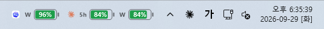
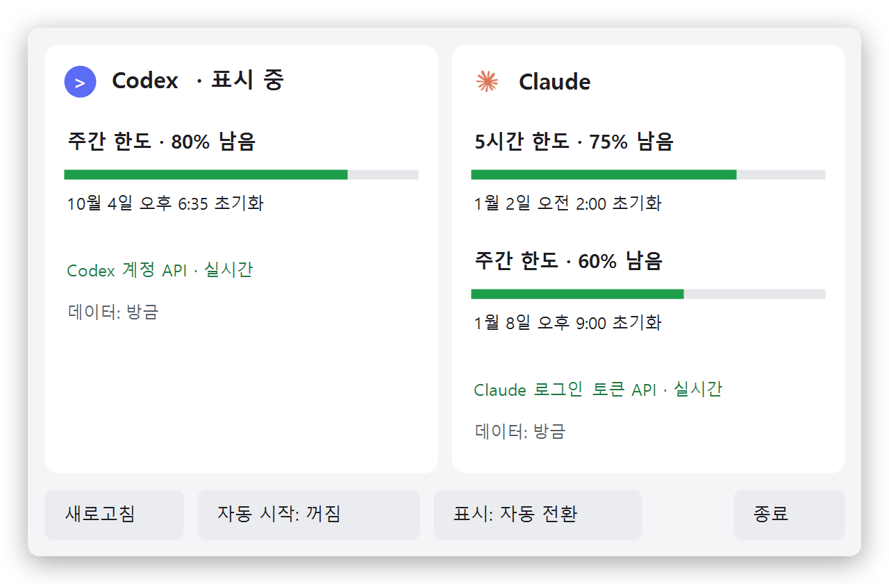

# CCusagebar (Windows)

**작업표시줄에 배터리 하나. Codex·Claude 남은 사용량을 한눈에.**

> Mac을 쓰시나요? 메뉴 막대 버전은 **[CCusagebar (mac)](https://github.com/share-seoi/CCusagebar-mac)** 에 있습니다.

<p align="center">
  <br>
  <sub>Codex를 쓰는 중</sub><br><br>
  <br>
  <sub>Claude를 쓰는 중</sub>
</p>

지금 쓰고 있는 앱의 남은 한도를 작업표시줄에 배터리로 보여줍니다. **Codex를 앞에 띄우면 Codex, Claude를 띄우면 Claude 사용량으로 자동으로 바뀌고**, 게임이나 브라우저 같은 다른 앱으로 넘어가면 마지막 표시를 그대로 둡니다.

배터리마다 `5h`(5시간 한도)·`W`(주간 한도) 이름표가 붙습니다. 계정에 한도가 둘이면(Claude, Codex Plus 등) 두 개가 나란히, 주간 한도만 있으면 `W` 하나만 나옵니다.

둘 다 계속 보고 싶으면 상세 창의 **표시** 버튼을 눌러 **둘 다**로 바꾸세요. Codex와 Claude가 나란히 뜹니다.

<p align="center">
  <br>
  <sub>표시: 둘 다</sub>
</p>

배터리를 누르면 두 계정의 한도와 초기화 시각이 함께 나옵니다. 그게 전부입니다.

<p align="center">
  <picture>
    <source media="(prefers-color-scheme: dark)" srcset="docs/images/popup-dark.png">
    
  </picture>
</p>

## 설치 (Windows 10/11)

PowerShell에서:

```powershell
git clone https://github.com/share-seoi/CCusagebar.git
cd CCusagebar
powershell -NoProfile -ExecutionPolicy Bypass -File .\install.ps1
```

- 관리자 권한, .NET SDK, Node, Python 모두 필요 없습니다. Windows에 기본으로 있는 .NET Framework 4.8로 소스에서 바로 빌드합니다.
- `%LOCALAPPDATA%\Programs\CCusagebar`에 `CCusagebar.exe`로 설치되고 바로 실행됩니다. 바탕화면 켜기/끄기 바로가기가 필요하면 `-DesktopShortcut`을 붙이세요.
- 로그인할 때 자동으로 켜지게 하려면 명령 끝에 `-AutoStart`를 붙이거나, 위젯 상세 창의 **자동 시작** 버튼을 누르세요.
- 설치 전에 코드를 확인하고 싶다면 `.\test.ps1`을 먼저 실행하세요. 네트워크 없이 합성 데이터로 동작을 검사합니다.

## 사용법

1. Codex 또는 Claude 데스크톱 앱에 평소처럼 로그인해 둡니다.
2. 둘 중 하나를 열면 작업표시줄에 사용량이 나타납니다. 둘 다 닫으면 위젯도 숨습니다.
3. 배터리를 누르면 상세 창이 열립니다: **새로고침**, **자동 시작** 켜기/끄기, **표시**(자동 전환 ↔ 둘 다), **종료**.

남은 양이 적으면 배터리가 빨갛게 바뀝니다.

## 어떻게 읽어 오나요

- **Codex:** 로컬 세션 기록을 20초마다 확인하고, 시작·새로고침 때와 Codex로 전환할 때(1분에 한 번까지) Codex 앱 서버로 계정 한도를 조회합니다. 다른 기기에서 쓴 양도 이때 반영됩니다. Codex 앱이 꺼져 있어도 Claude 앱이 켜져 있으면 로컬 기록을 1분마다 확인합니다.
- 상세 창의 연결 상태에 **마지막 조회** 시각이 나옵니다.
- **Claude:** 이 PC에 저장된 Claude 로그인 토큰을 **읽기만** 해서 사용량 API를 조회합니다. 배터리가 Claude를 표시 중이면 1분, 아니면 3분 간격이고, Claude로 전환하거나 상세 창을 열면 바로 새로 받아옵니다. 모델 추론은 요청하지 않습니다.
- 배터리가 흐려지면 표시 중인 숫자가 10분 넘게 갱신되지 않았다는 뜻입니다. 이유는 상세 창에 나옵니다.
- 토큰을 복사·수정·전송하지 않으며, 저장소에도 계정 정보는 들어 있지 않습니다. 설치하는 사람의 PC에 로그인된 계정이 표시됩니다.
- 시작·종료·오류 같은 드문 사건만 `%LOCALAPPDATA%\CCusagebar\log.txt`에 남깁니다(최대 256KB).

자세한 동작과 진단 옵션은 [상세 안내](docs/details.md)를 참고하세요.

## 제거

1. 자동 시작을 켰다면 위젯 상세 창에서 먼저 끕니다.
2. 상세 창에서 **종료**를 누릅니다.
3. `%LOCALAPPDATA%\Programs\CCusagebar`(프로그램)와 `%LOCALAPPDATA%\CCusagebar`(마지막 사용량 캐시·기록) 폴더를 지웁니다.

## 참고

- 개인이 만든 비공식 도구이며 OpenAI, Anthropic과 관계가 없습니다.
- 사용량 조회에 쓰는 API는 공개적으로 보장된 API가 아니어서, 앱이 업데이트되면 동작이 바뀔 수 있습니다.
- 에이전트(Codex, Claude Code 등)에게 설치를 맡길 때는 [AGENTS.md](AGENTS.md)를 읽게 하면 됩니다.
- 예전 주소 `share-seoi/CodexUsageBar`는 이제 Mac 버전 저장소(`CCusagebar-mac`)로 연결됩니다. 예전에 받은 폴더에서 Windows 버전을 계속 받으려면 `git remote set-url origin https://github.com/share-seoi/CCusagebar.git`을 실행하세요.

## 라이선스

[MIT](LICENSE)
